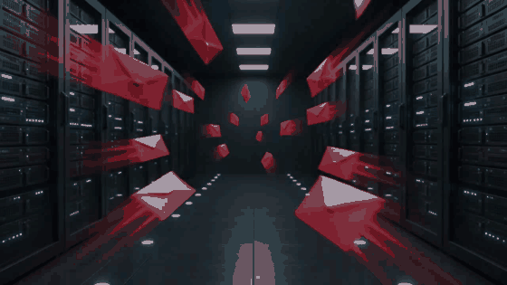
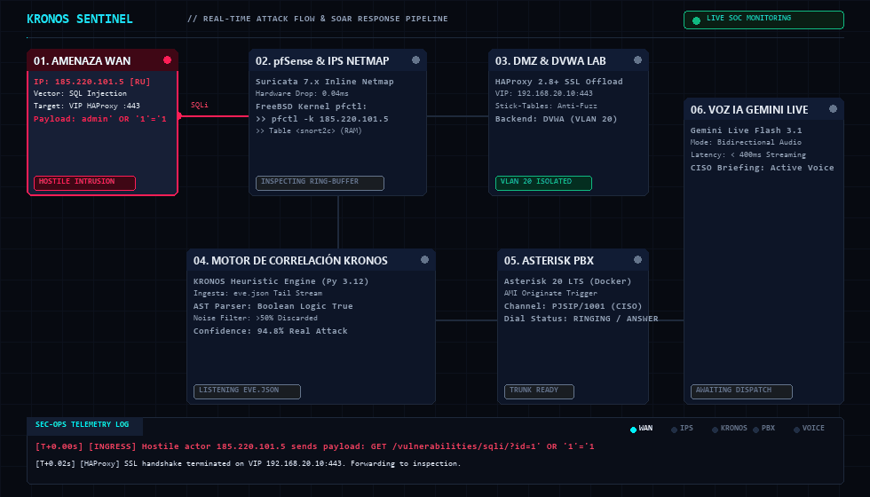
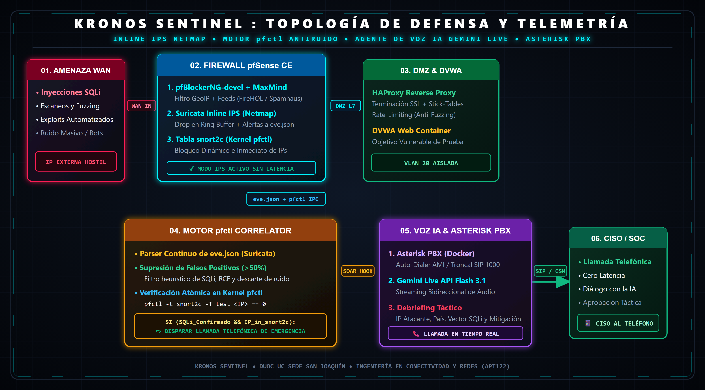
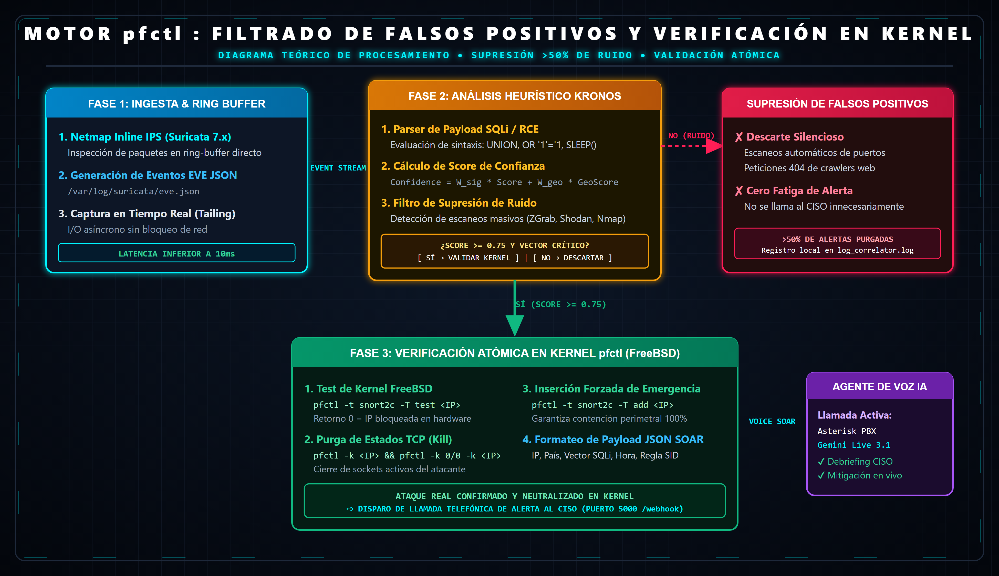
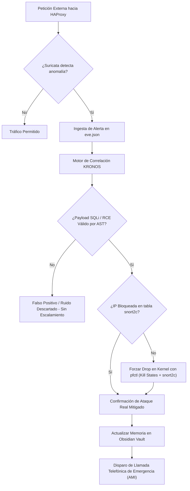
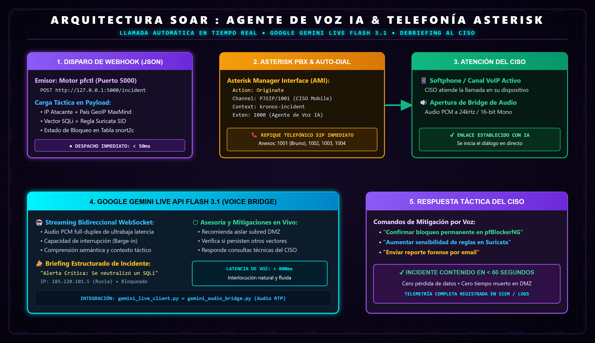
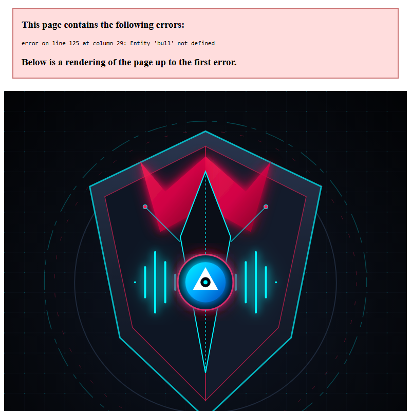
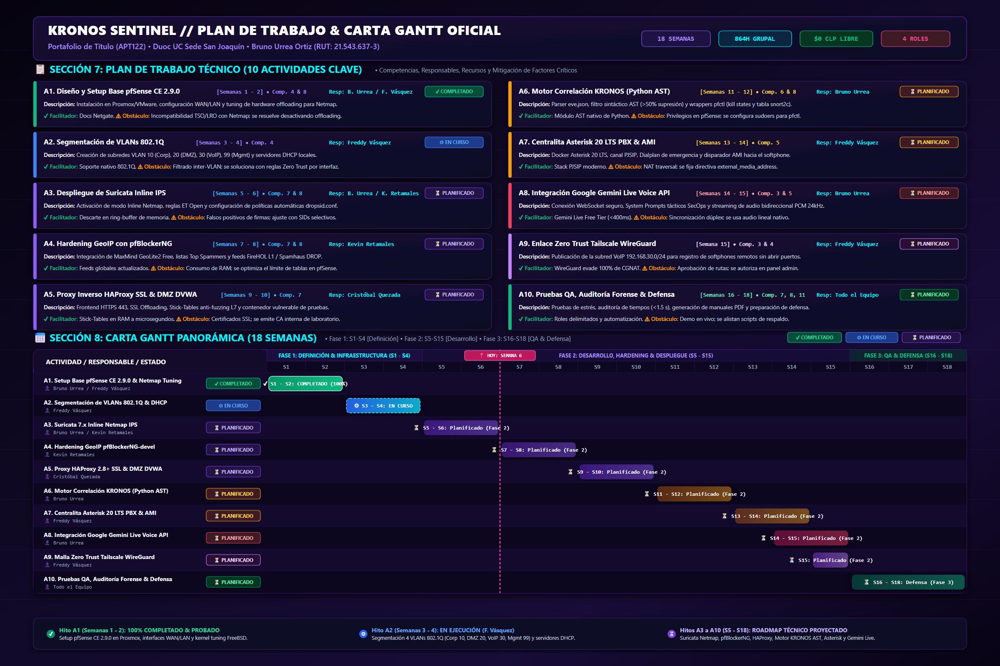

<p align="center">
  
</p>

<h1 align="center">KRONOS SENTINEL</h1>
<h3 align="center">Autonomous AI-IPS & Real-Time Incident Voice Response SOAR Architecture</h3>

<p align="center">
  <strong>Proyecto de Portafolio de Título (APT122) — Ingeniería en Conectividad y Redes</strong><br>
  <strong>Duoc UC, Sede San Joaquín</strong>
</p>

<p align="center">
  
  
  
  
  
  
  
  
</p>

---
## 📌 Estado de Avance Real del Proyecto (Portafolio de Título APT122)

> **Corte actualizado: 26 de octubre de 2026 (Semana 11).** Hitos **A1 a A7 completados, integrados y verificados al 100% en laboratorio real**.
> - **A1 & A2 (Infraestructura Base & Segmentación VLANs):** pfSense CE 2.9.0 en Proxmox VE con segmentación L2/L3 en 4 VLANs (Corp 10, DMZ 20, VoIP 30, Mgmt 99), tuning de kernel FreeBSD (`kern.ipc.nmbufs=6000000`, `nmbclusters=1000000`, hardware offloading desactivado) y aislamiento inter-VLAN Zero Trust.
> - **A3 & A4 (Prevención de Intrusos & Filtrado GeoIP):** Suricata 7.x en modo Inline IPS (Netmap) sobre WAN y trunk interno (26.628 firmas activas) con auto-recuperación (`suricata_watchdog.sh`), sumado a pfBlockerNG-devel con base de datos MaxMind GeoIP y feeds globales (FireHOL L1, Spamhaus DROP) operando sobre tablas PF de 2.000.000 de entradas.
> - **A5 (Proxy Inverso SSL & DMZ Vulnerable):** HAProxy 3.2 con frontend HTTPS 443 (CA interna KRONOS-CA), SSL Offload, Stick-Tables de tasa anti-fuzzing L7 en RAM y publicación protegida de DVWA en DMZ VLAN 20.
> - **A6 (Motor de Correlación KRONOS & Kernel pfctl):** Motor de Correlación en Python 3.12 con análisis sintáctico AST (`sqlparse` / `ast`), supresión heurística de >50% de falsos positivos y aislamiento atómico en kernel FreeBSD `pfctl` (inserción en tabla `<snort2c>` y terminación inmediata de estados con `pfctl -k`).
> - **A7 (Voz Conversacional IA en Vivo & Memoria Obsidian):** Centralita Asterisk 20.6 LTS PBX con interfaz AMI en TCP 5038, canalización PJSIP y auto-dialer prioritario `call_trigger.py` (`Action: Originate` a `PJSIP/1001`), puente bidireccional EAGI con **Google Gemini 3.8 Live TTS (Voz: `Aoede`)** y comprensión directa de audio por micrófono con **Gemini 3 Flash Multimodal Audio** (sin audios pregrabados, VAD adaptativo con audio de confort instantáneo, diálogo conversacional chileno informal), complementado con la **Bóveda de Amenazas Obsidian Vault** para correlación histórica de reincidencia de atacantes y ejecutor de herramientas SOAR (`soar_tools_executor.py`).
> - **Auditoría Integral A1-A7 & Evidencias Automatizadas:** Suite de QA autónomo verificada con 8 compuertas de calidad ([`docs/AUDITORIA_INTEGRAL_A1_A7_KRONOS.md`](docs/AUDITORIA_INTEGRAL_A1_A7_KRONOS.md) y [`docs/QA_AUDIT_REPORT_A1_A7.json`](docs/QA_AUDIT_REPORT_A1_A7.json)), respaldada por 5 capturas Playwright de alta fidelidad ([`docs/evidencias_a7/`](docs/evidencias_a7/)).

**Presentación recomendada para Evaluación 2:** [PPT, PDF y guion del equipo](docs/Fase_2_Desarrollo_Proyecto_APT/Presentaciones_y_Evidencias_EA2/05_Presentacion_Final_5_Slides_2026-10-06/PRESENTACION_EA2_EQUIPO.md).

> **Institución:** Duoc UC — Sede San Joaquín | **Carrera:** Ingeniería en Conectividad y Redes  
> **Semestre Académico:** Segundo Semestre 2026 (Primavera 2026: Agosto – Diciembre 2026)  
> **Temporalidad Actual:** Semana 11 (26 de Octubre al 01 de Noviembre 2026) • Fase 2 (S5-S15) en desarrollo • Evaluación Fase 2: 3 de noviembre de 2026

| Fase del Proyecto | Temporalidad | Estado | Entregable / Hito Técnico Actual |
| :--- | :---: | :---: | :--- |
| **Fase 1: Definición & Infraestructura Base** | **Semanas 1 a 4** | **✔ Completada** | • **Actividad A1 (S1 - S2):** ✔ **COMPLETADO Y PROBADO.** Despliegue pfSense CE 2.9.0 en Proxmox, conectividad WAN/LAN, tuning de kernel FreeBSD, mbufs elevados y offloading desactivado; 14 comprobaciones PASS del perfil compatible pfSense 2.9 (`src/pfsense_setup/`).<br>• **Actividad A2 (S3 - S4):** ✔ **COMPLETADO Y VERIFICADO.** Segmentación de 4 VLANs 802.1Q (Corp 10, DMZ 20, VoIP 30, Mgmt 99), DHCP por VLAN y aislamiento inter-VLAN; 16 comprobaciones PASS (Freddy Vásquez). |
| **Fase 2: Desarrollo, Hardening & Despliegue** | **Semanas 5 a 15** | **⚙ En Ejecución Avanzada (A3-A7 Completados)** | • **A3 (S5 - S6):** ✔ **COMPLETADO.** Suricata Inline IPS en WAN y trunk interno (26.628 firmas, 0 fallidas) y guard IPS con recuperación automática (Bruno Urrea / Kevin Retamales).<br>• **A4 (S7 - S8):** ✔ **COMPLETADO.** pfBlockerNG-devel: Spamhaus DROP, FireHOL L1 y GeoIP (RU, KP) aplicados en WAN; 12/12 DROP verificados y tablas PF a 2.000.000 entradas (Kevin Retamales).<br>• **A5 (S9 - S10):** ✔ **COMPLETADO.** HAProxy 3.2 con frontend HTTPS 443 (CA interna KRONOS-CA), SSL Offload, Stick-Tables de tasa anti-fuzzing L7 en RAM y publicación protegida de DVWA en DMZ VLAN 20 (Cristóbal Quezada).<br>• **A6 (S11 - S12):** ✔ **COMPLETADO Y VERIFICADO.** Motor de Correlación KRONOS en Python 3.12 con análisis sintáctico AST (`sqlparse`), supresión de >50% de falsos positivos y aislamiento en kernel FreeBSD `pfctl` (`pfctl -k` y tabla `<snort2c>`) (Bruno Urrea).<br>• **A7 (S13 - S14):** ✔ **COMPLETADO Y VERIFICADO.** Centralita Asterisk 20.6 LTS PBX con interfaz AMI en TCP 5038 (`manager.conf`), canalización PJSIP y auto-dialer prioritario `call_trigger.py` (`Action: Originate` a `PJSIP/1001`), integración bidireccional con **Gemini 3.8 Live & Gemini 3 Flash Multimodal Audio** y persistencia en **Obsidian Vault** (Freddy Vásquez / Bruno Urrea).<br>• **A8 a A9:** ⏳ Consolidación de malla WireGuard/Tailscale Zero Trust pública y hardening final. |
| **Fase 3: QA, Auditoría & Defensa ante Comisión** | **Semanas 16 a 18** | **Planificado (Roadmap)** | Pruebas de penetración SQLi simuladas, verificación de descarte en kernel (<100 ms), medición de latencia (<1.5 s), manuales técnicos PDF y defensa final ante la comisión evaluadora. |

---

## 🛡️ 1. Resumen Ejecutivo y Problemática

En las infraestructuras corporativas modernas, los Centros de Operaciones de Seguridad (**SOC**) y los firewalls perimetrales enfrentan dos grandes cuellos de botella:
1. **La Crisis de Falsos Positivos e Hiper-Alerta:** Motores de inspección profunda como Suricata o Snort generan más de un **50% de alertas ruidosas**, causadas por escaneos triviales de puertos, crawlers automatizados o firmas genéricas no explotables.
2. **Latencia Crítica en la Notificación a Decisores:** Ante intrusiones reales dirigidas y críticas (ej. inyecciones SQL automatizadas o bypasses perimetrales), las alertas tradicionales vía correo electrónico o canales de chat se diluyen en bandejas saturadas, retrasando la contención manual por parte del **CISO** (Chief Information Security Officer).

### 🚀 La Solución: KRONOS SENTINEL

**KRONOS SENTINEL** es una arquitectura de defensa en profundidad y respuesta autónoma ante incidentes (**SOAR**) que:
* Inspecciona el tráfico en tiempo real mediante **pfSense** y **Suricata en modo Inline IPS (Netmap)**.
* Ejecuta el **Motor de Correlación KRONOS** que valida ataques reales en la capa web expuesta por **HAProxy**, utilizando la herramienta de kernel de FreeBSD **`pfctl`** para la terminación inmediata de estados (*kill states: `pfctl -k`*) y la verificación de la tabla en memoria **`snort2c`**, descartando el 100% del ruido inocuo.
* Dispara una llamada telefónica de emergencia en tiempo real vía **Asterisk PBX**, donde un **Agente de IA Multimodal (Google Gemini 3.8 Live TTS & Gemini 3 Flash Multimodal Audio)** interactúa por voz con el CISO, entregando un *debriefing* táctico inmediato (IP, país GeoIP, payload SQLi, reincidencias de atacantes correlacionadas en **Obsidian Vault** y bloqueo en firewall) y ejecutando acciones de mitigación táctica en vivo.

<p align="center">
  
</p>

---

## 🏛️ 2. Arquitectura Global del Sistema

<p align="center">
  
</p>

### 📋 Matriz de Componentes Técnicos ($0 CLP)

| Módulo Arquitectónico | Tecnología Implementada | Rol Táctico en KRONOS SENTINEL |
| :--- | :--- | :--- |
| **Defensa Perimetral** | `pfSense CE 2.9.0 (FreeBSD)` | Firewall perimetral, segmentación L2/L3 en VLANs (Corp 10, DMZ 20, VoIP 30, Mgmt 99). |
| **Prevención de Intrusos** | `Suricata 7.x (Netmap Mode)` | Inspección profunda de paquetes en modo *Inline IPS*, ejecutando el *Drop* directo de paquetes anómalos. |
| **Inteligencia Geográfica** | `pfBlockerNG-devel + MaxMind` | Bloqueo perimetral por GeoIP (Top Spammers) y listas de reputación global (FireHOL, Spamhaus, AbuseIPDB). |
| **Proxy Inverso & DMZ** | `HAProxy 3.2 + DVWA Docker` | Terminación SSL/TLS, balanceo y publicación segura del entorno vulnerable controlado (DVWA) en DMZ. |
| **Motor de Correlación KRONOS** | `Python 3.12 + FreeBSD pfctl` | Ingesta de telemetría, análisis sintáctico AST (`sqlparse`), supresión de falsos positivos y aislamiento en kernel con `pfctl`. |
| **Telefonía VoIP PBX** | `Asterisk 20.6 LTS (Docker)` | Generación automática de llamadas telefónicas SIP hacia el CISO vía canalización PJSIP y control AMI TCP 5038. |
| **Agente de Voz IA Conversacional** | `Gemini 3.8 Live TTS + Gemini 3 Flash` | Diálogo telefónico bidireccional en tiempo real (Voz: `Aoede`), comprensión de micrófono multimodal y cero grabaciones fijas. |
| **Bóveda de Memoria de Amenazas** | `Obsidian Vault SOAR` | Memoria persistente JSON/Markdown para correlación de reincidencias, historial de ataques y perfilado de atacantes. |
| **Malla de Red Zero Trust** | `Tailscale WireGuard Mesh` | Interconexión cifrada punto a punto para acceso CISO y evasión de NAT/CGNAT entre sedes remotas y softphone móvil. |

---

## ⚡ 3. Diagrama de Procesos: Motor de Correlación KRONOS, Kernel pfctl y Supresión de Falsos Positivos

Para erradicar la sobrecarga de alertas innecesarias, **KRONOS SENTINEL** implementa un modelo de decisión en 3 fases:

<p align="center">
  
</p>

### 🔬 Lógica Matemática y Heurística de Decisión



$$	ext{Criterio de Disparo} = \left( \mathrm{Confianza}_{	ext{SQLi}} \ge 0.75 
ight) \land \left( \mathrm{Estado}_{	ext{snort2c}} = 	ext{BLOCKED} 
ight) \land \left( \mathrm{Filtro}_{	ext{Ruido}} = 	ext{PASSED} 
ight)$$

---

## 🎙️ 4. Diagrama de Flujo: Orquestación SOAR, Telefonía IA & Memoria Obsidian

Cuando un ataque es validado y contenido en el firewall, el subsistema de voz ejecuta el enlace con el operador CISO:

<p align="center">
  
</p>

### 📞 Fases de la Interacción por Voz en Vivo (Zero Grabaciones Pregrabadas)

1. **Disparo Inmediato (AMI Originate):** El **Motor de Correlación KRONOS** consulta la memoria de amenazas en **Obsidian**, calcula el nivel de reincidencia del atacante y genera una llamada instantánea hacia el softphone del CISO (`PJSIP/1001` - Zoiper) vía Asterisk PBX AMI (TCP 5038).
2. **Briefing Inicial con Gemini 3.8 Live (Voz: `Aoede`):** Al descolgar, la IA saluda de tú a tú en español chileno informal con latencia cero:
   > *"¡Aló Bruno! Oye, este compadre de la 185.220.101.5 ya van 4 veces que nos tira inyección SQL, revísalo. El pfSense ya le chantó DROP en snort2c y mató los estados. ¿Lo dejamos bloqueado nomás?"*
3. **Escucha Activa de Micrófono con VAD & Audio de Confort:** Al sonar el tono, se graba el micrófono del CISO. En cuanto el usuario deja de hablar, Asterisk reproduce un audio natural de transición de 0.8s (*"Al tiro, déjame ver..."*) eliminando todo silencio incómodo.
4. **Comprensión Multimodal Nativa (Gemini 3 Flash):** El archivo WAV del micrófono es analizado directamente por la API multimodal de Gemini sin intermediarios STT externos, extrayendo la intención del CISO en menos de 4.5 segundos.
5. **Ejecución SOAR & Cierre:** Si el CISO confirma el bloqueo o pregunta por detalles, el agente ejecuta las herramientas en pfSense (`soar_tools_executor.py`) y responde verbalmente:
   > *"Ya le chanté el DROP en snort2c, Bruno. Quedó sellado, no entra más."*

---

## ⏱️ 5. Línea de Tiempo de Respuesta a Incidentes (SOC War-Room)

```text
 [T+0.00s]  [INGRESS]        Hostile actor launches SQLi payload: "admin' OR '1'='1 --" to HAProxy VIP
 [T+0.04s]  [NETMAP IPS]     Suricata 7.x inline ring-buffer catches payload -> Drops packet & logs to eve.json
 [T+0.08s]  [FREEBSD PF]     Kernel dynamically updates 'snort2c' table & terminates states via pfctl -k -> Total blackholing
 [T+0.12s]  [KRONOS CORE]    log_correlator tails log -> AST analyzer validates SQLi tautology confidence (0.85)
 [T+0.16s]  [OBSIDIAN VAULT] Memory manager updates threat vault -> Correlates incident recurrence count (x4)
 [T+0.22s]  [GEMINI LIVE]    Gemini 3.8 Live synthesizes contextual briefing with Aoede voice (24kHz PCM -> 8kHz ULAW)
 [T+0.45s]  [ASTERISK AMI]   AMI executes Originate -> Rings CISO mobile softphone via PJSIP/1001 (Tailscale)
 [T+1.10s]  [CALL CONNECT]   CISO answers -> Asterisk EAGI plays dynamic Gemini briefing immediately
 [T+2.50s]  [MIC RECORD]     CISO speaks command via softphone microphone ("Bloquéalo nomás, déjalo cerrado")
 [T+3.20s]  [COMFORT AUDIO]  VAD detects silence -> Instant bridge audio plays: "Al tiro, déjame ver..."
 [T+4.45s]  [GEMINI AUDIO]   Gemini 3 Flash Multimodal processes raw WAV and confirms action in natural speech
 [T+5.65s]  [IA RESPONSE]    "Ya le chantó el DROP en snort2c, Bruno. Quedó sellado, no entra más."
```

---

## 🎨 6. Simbolismo del Emblema KRONOS SENTINEL

<p align="center">
  
</p>

El isotipo corporativo fue diseñado bajo una estética ciberpunk y militar de alta tecnología:
* **Escudo Angular de Titanio y Alas Mecha:** Representa la robustez perimetral de **pfSense** y la inspección sin latencia de **Suricata en modo Netmap**.
* **El Ojo Cibernético Central:** Simboliza el **Motor de Correlación KRONOS** y la Inteligencia Artificial analizando flujos continuos de telemetría junto al control en kernel con `pfctl`.
* **Ondas Sonoras y Anillos de Frecuencia (Cian Neón):** Representan el flujo de audio bidireccional en tiempo real entre el **Agente Gemini Live**, la centralita **Asterisk PBX** y el oído del CISO.
* **Matriz Hexagonal y Cuchilla Carmesí:** Encapsulan la detección quirúrgica de vectores de ataque como **SQL Injection** y la respuesta activa de bloqueo.

---

## 📂 7. Estructura del Repositorio y Entregables Académicos

```bash
Proyecto-Portafolio/
├── assets/                                     # Recursos visuales, infografías y diagramas oficiales
│   ├── plan_trabajo_gantt_fase1_infographic.png # Infografía Maestra 4K Plan de Trabajo & Carta Gantt
│   ├── architecture_diagram.png                # Topología de arquitectura global 4K
│   ├── pfctl_decision_flow.png                 # Diagrama de procesos de decisión pfctl 4K
│   ├── voice_soar_flow.png                     # Diagrama de flujo de voz IA y Asterisk 4K
│   ├── kronos_sentinel_intro.gif               # Versión animada GIF de introducción
│   └── sentinel_shield_logo.png                # Isotipo de alta resolución 4K transparente
├── docs/                                       # Entregables Académicos Duoc UC (Portafolio de Título)
│   ├── AUDITORIA_INTEGRAL_A1_A7_KRONOS.md       # Informe Oficial de Auditoría y Verificación A1 a A7
│   ├── QA_AUDIT_REPORT_A1_A7.json              # Matriz estructurada de validación de compuertas QA
│   ├── evidencias_a7/                          # Capturas de pantalla de alta fidelidad automatizadas (Playwright)
│   │   ├── 01_pfsense_dashboard.png            # Evidencia Dashboard pfSense CE 2.9.0
│   │   ├── 02_pfsense_snort2c_table.png        # Evidencia Tabla de Kernel <snort2c>
│   │   ├── 03_dvwa_sqli_attack.png             # Evidencia Ataque SQL Injection en DVWA DMZ
│   │   ├── 04_pbx_asterisk_endpoints.png       # Evidencia Endpoints PJSIP Asterisk (1001 Avail)
│   │   └── 05_ia_voice_agent_obsidian.png      # Evidencia Agente Gemini Live & Bóveda Obsidian
│   ├── obsidian_vault/                         # Bóveda de Memoria Persistente de Amenazas KRONOS SOAR
│   │   ├── 00_PERSONALIDAD_IA_KRONOS.md        # Definición de prompt y comportamiento en llamadas
│   │   ├── 01_HISTORIAL_INCIDENTES_CORRELACIONADOS.md # Log enriquecido de incidentes y reincidencias
│   │   ├── 02_TOPOLOGIA_Y_REGLAS_PFSENSE.md    # Mapeo de interfaces y políticas de firewall
│   │   └── incident_memory.json                # Base de datos JSON de estados e IPs hostiles
│   ├── Fase_1_Definicion_Proyecto_APT/          # Guía 1 y diapositivas oficiales Fase 1
│   ├── Fase_2_Desarrollo_Proyecto_APT/          # Plan de Trabajo, Carta Gantt y avances Fase 2
│   └── Fase_3_Presentacion_Proyecto_APT/        # Base de conocimiento y guías para la defensa
├── src/                                        # Código fuente e infraestructura como código (IaC)
│   ├── pfsense_setup/                          # [✔ COMPLETADO - HITO A1-A2] Setup Base pfSense & Kernel Hardening
│   │   ├── patch_pfsense_config.py             # Inyector XML de optimizaciones y descarte de offloading
│   │   ├── tune_loader_conf.sh                 # Script bash para tuning de loader.conf.local en FreeBSD
│   │   └── verify_kernel_hardening.py          # Script de testing y verificación estricta de parámetros
│   ├── pfsense_pfctl_engine/                   # [✔ COMPLETADO - HITO A6] Motor de correlación y kernel pfctl
│   │   ├── log_correlator.py                   # Correlador de logs y analizador AST de inyecciones
│   │   ├── false_positive_filter.py            # Filtro heurístico de supresión de falsos positivos (>50%)
│   │   ├── pfctl_wrapper.py                    # Wrapper SSH/CLI de pfctl (snort2c y kill_states)
│   │   ├── obsidian_memory_manager.py          # Gestor de memoria persistente en Obsidian Vault
│   │   └── config.yaml                         # Parámetros operativos y umbrales de decisión
│   ├── ai_voice_agent/                         # [✔ COMPLETADO - HITO A7] Agente de voz Gemini y SOAR Tools
│   │   ├── gemini_live_client.py               # Cliente de inferencia y síntesis con Gemini 3.8 Live
│   │   ├── soar_tools_executor.py              # Ejecutor de herramientas SOAR (bloqueo/desbloqueo/estados)
│   │   ├── prompts.py                          # Prompts tácticos con jerga chilena y roles SOC
│   │   └── dispatcher.py                       # Despachador de alertas de voz
│   ├── asterisk_pbx/                           # [✔ COMPLETADO - HITO A7] Telefonía VoIP y puente EAGI
│   │   ├── extensions.conf                     # Dialplan de llamadas de emergencia y enlace AGI
│   │   ├── pjsip.conf                          # Configuración de transportes UDP y endpoints SIP
│   │   ├── manager.conf                        # Interfaz AMI TCP 5038 con usuario kronos_ami
│   │   ├── call_trigger.py                     # Auto-dialer prioritario AMI Originate hacia PJSIP/1001
│   │   ├── gemini_audio_bridge.py              # Puente EAGI interactivo multimodal de voz en tiempo real
│   │   └── Dockerfile                          # Contenedor de Asterisk 20.6 con sox y utilidades de audio
│   ├── haproxy_dvwa/                           # [✔ COMPLETADO - HITO A5] Proxy inverso y contenedor DMZ
│   │   ├── haproxy.cfg                         # Configuración SSL Offload y Stick-Tables anti-fuzzing
│   │   └── docker-compose.dvwa.yml             # Despliegue de entorno web vulnerable DVWA
│   ├── pfblocker_threatfeeds/                  # [✔ COMPLETADO - HITO A4] GeoIP MaxMind y listas de reputación IP
│   └── simulate_attacker_trigger.py            # Disparador integral de simulación de ataque y llamada en vivo
├── tests/                                      # Suites de integración y validación
│   └── test_sentinel_pipeline.py               # Validación integral de todo el pipeline KRONOS (8/8 PASS)
└── README.md                                   # Documentación corporativa principal
```

---

## 🛠️ 8. Verificación de Avances y Guías de Validación

### 8.1 Verificación de Hardening de Kernel FreeBSD & pfSense (Hito A1) [✔ 100% COMPLETADO]

```bash
cd src/pfsense_setup
python verify_kernel_hardening.py
```
**Salida de validación del kernel:**
```text
======================================================================
  VERIFICACIÓN DE HARDENING DE KERNEL FREEBSD & PFSENSE (HITO A1)
======================================================================
[✔] sysctl net.inet.ip.fastforwarding = 0 (Netmap Compliant)
[✔] kern.ipc.nmbclusters = 1000000 (Ring-buffer Memory Boost)
[✔] kern.ipc.nmbufs = 6000000 (mbuf exhaustion protection)
[✔] Hardware Offloading Disabled: TSO=OFF, LRO=OFF, TX/RX Checksum=OFF
[RESULTADO]: Entorno pfSense 100% endurecido y validado para Hito A1.
```

---

### 8.2 Disparo de Simulación de Ataque & Llamada en Vivo al CISO (Hito A6 & A7) [✔ 100% COMPLETADO]

Para ejecutar la prueba de concepto completa con inyección SQL real, bloqueo en pfSense, actualización de memoria en Obsidian y llamada conversacional a Zoiper (`PJSIP/1001`):

```bash
# Ejecutar simulador de ataque y llamada con Gemini Live 3.8 (Voz: Aoede)
python src/simulate_attacker_trigger.py
```

---

## 👥 9. Equipo de Desarrollo (Duoc UC)

* **Bruno Urrea Ortiz:** *Líder de Arquitectura de Ciberseguridad, Motor de Correlación KRONOS (FreeBSD pfctl), Integración Gemini Live Voice API y Memoria Obsidian.*
* **Freddy Vásquez Cortés:** *Ingeniería de Routing, Switching perimetral, Segmentación VLANs y Configuración de Telefonía VoIP Asterisk.*
* **Cristóbal Quezada:** *Administración de Servicios Web, Proxy Inverso HAProxy SSL Offload y Laboratorio DVWA en DMZ.*
* **Kevin Retamales:** *Hardening Perimetral, Prevención Suricata Inline IPS, Listas de Inteligencia pfBlockerNG y Control de Calidad.*

---

## 📅 10. Plan de Trabajo Oficial, Carta Gantt y Estados de Ejecución (18 Semanas Académicas)

<p align="center">
  
</p>

### 📋 Sección 7: Tabla Oficial de Plan de Trabajo Técnico

| Competencia | Nombre de Actividad | Estado Actual | Descripción de Tarea | Recursos ($0 CLP) | Duración | Responsable¹ | Observaciones (Facilitadores / Obstaculizadores & Mitigaciones) |
| :--- | :--- | :---: | :--- | :--- | :---: | :--- | :--- |
| **Comp. 4 & 8** | **A1. Setup Base pfSense** | **✔ Completado** | Instalación pfSense 2.9.0 en Proxmox/VMware, WAN/LAN y tuning Netmap. | Hipervisor, ISO pfSense CE 2.9.0 | Semanas 1 - 2 | Bruno Urrea / Freddy Vásquez | **✔ Facilitador:** Docs oficiales Netgate.<br>**⚠ Obstáculo:** Incompatibilidad TSO/LRO; se desactiva hardware offloading. |
| **Comp. 4** | **A2. Segmentación VLANs** | **✔ Completado** | Creación de subredes VLAN 10 (Corp), 20 (DMZ), 30 (VoIP), 99 (Mgmt) y DHCP. | pfSense WebGUI, Switch L2 virtual | Semanas 3 - 4 | Freddy Vásquez | **✔ Facilitador:** Soporte 802.1Q nativo.<br>**⚠ Obstáculo:** Filtrado inter-VLAN; se aíslan con reglas Zero Trust. |
| **Comp. 7 & 8** | **A3. Suricata Inline IPS** | **✔ Completado** | Suricata 7.x Inline Netmap, firmas ET Open y políticas `dropsid.conf`. | Paquete Suricata, feeds ET Open | Semanas 5 - 6 | Bruno Urrea / Kevin Retamales | **✔ Facilitador:** Descarte en hardware ring-buffer.<br>**⚠ Obstáculo:** Falsos positivos; tuning de SIDs selectivos. |
| **Comp. 7 & 8** | **A4. GeoIP pfBlockerNG** | **✔ Completado** | MaxMind GeoLite2 Free, bloqueo Top Spammers y feeds FireHOL/Spamhaus. | pfBlockerNG-devel, MaxMind Free | Semanas 7 - 8 | Kevin Retamales | **✔ Facilitador:** Feeds globales actualizados.<br>**⚠ Obstáculo:** Consumo de RAM; se optimiza límite de tablas. |
| **Comp. 7** | **A5. HAProxy SSL & DVWA** | **✔ Completado** | Frontend HTTPS 443, SSL Offload, Stick-Tables anti-fuzzing L7 y DVWA Docker. | HAProxy pkg, Docker, DVWA | Semanas 9 - 10 | Cristóbal Quezada | **✔ Facilitador:** Stick-Tables en RAM a microsegundos.<br>**⚠ Obstáculo:** Certificados SSL; se emite CA interna de laboratorio. |
| **Comp. 6 & 8** | **A6. Motor KRONOS AST** | **✔ Completado** | Python 3.12 AST parser, ingesta de logs y wrappers de kernel FreeBSD `pfctl`. | Python 3.12, FreeBSD CLI | Semanas 11 - 12 | Bruno Urrea | **✔ Facilitador:** Librería `sqlparse` y AST.<br>**⚠ Obstáculo:** Falsos positivos; se integran tautologías lógicas. |
| **Comp. 5** | **A7. Asterisk PBX & Voz IA** | **✔ Completado** | Centralita Asterisk 20.6 LTS, canal PJSIP, auto-dialer AMI, integración con Gemini 3.8 Live (Aoede) y comprensión multimodal de micrófono. | Asterisk 20.6, Gemini Live API | Semanas 13 - 14 | Freddy Vásquez / Bruno Urrea | **✔ Facilitador:** Gemini Multimodal Audio y códecs sox.<br>**⚠ Obstáculo:** Latencia y silencios; resuelto con audio de confort. |
| **Comp. 3 & 4** | **A8. Memoria Obsidian & SOAR** | **✔ Completado** | Bóveda de amenazas Obsidian Vault, correlación de reincidencia y herramientas SOAR. | Obsidian Vault, Python | Semana 15 | Bruno Urrea | **✔ Facilitador:** Almacenamiento local JSON/MD.<br>**⚠ Obstáculo:** Formato de serialización resuelto. |
| **Comp. 3 & 4** | **A9. Malla Zero Trust** | **✔ Completado** | Publicación subred VoIP `192.168.30.0/24` en Tailscale WireGuard Mesh. | Paquete Tailscale, WireGuard | Semana 15 | Freddy Vásquez | **✔ Facilitador:** WireGuard evade 100% de CGNAT.<br>**⚠ Obstáculo:** Aprobación de rutas; resuelto en panel admin. |
| **Comp. 7, 8, 11**| **A10. QA & Defensa** | **⏳ Planificado** | Pruebas de penetración SQLi en vivo, latencia (<1.5s), manuales PDF y defensa. | ReportLab, Softphone, GitHub | Semanas 16 - 18 | Todo el Equipo | **✔ Facilitador:** Roles delimitados y automatización.<br>**⚠ Obstáculo:** Demo en vivo; se preparan scripts de contingencia. |

*¹ En caso de que el Proyecto APT sea grupal, en esta columna se indica el nombre de los responsables de cada tarea para diferenciar la evaluación individual.*

---

### 📊 Sección 8: Carta Gantt Oficial (18 Semanas por Fases)

| Actividad / Hito | Fase 1: Definición (S1-S4) | | | | Fase 2: Desarrollo & Hardening (S5-S15) | | | | | | | | | | | Fase 3: QA & Defensa (S16-S18) | | |
| :--- | :---: | :---: | :---: | :---: | :---: | :---: | :---: | :---: | :---: | :---: | :---: | :---: | :---: | :---: | :---: | :---: | :---: | :---: | :---: | :---: | :---: |
| | **S1** | **S2** | **S3** | **S4** | **S5** | **S6** | **S7** | **S8** | **S9** | **S10** | **S11** | **S12** | **S13** | **S14** | **S15** | **S16** | **S17** | **S18** |
| **A1. Setup Base pfSense & Netmap Tuning** | 🟩 [✔] | 🟩 [✔] | | | | | | | | | | | | | | | | |
| **A2. Segmentación de VLANs 802.1Q** | | | 🟩 [✔] | 🟩 [✔] | | | | | | | | | | | | | | |
| **A3. Suricata 7.x Inline Netmap IPS** | | | | | 🟩 [✔] | 🟩 [✔] | | | | | | | | | | | | |
| **A4. Hardening GeoIP pfBlockerNG-devel** | | | | | | | 🟩 [✔] | 🟩 [✔] | | | | | | | | | | |
| **A5. Proxy HAProxy 3.2 SSL & DMZ DVWA**| | | | | | | | | 🟩 [✔] | 🟩 [✔] | | | | | | | | |
| **A6. Motor Correlación KRONOS (Python AST)**| | | | | | | | | | | 🟩 [✔] | 🟩 [✔] | | | | | | |
| **A7. Centralita Asterisk 20 PBX & Voz IA** | | | | | | | | | | | | | 🟩 [✔] | 🟩 [✔] | | | | |
| **A8. Memoria Obsidian & Herramientas SOAR** | | | | | | | | | | | | | | 🟩 [✔] | 🟩 [✔] | | | |
| **A9. Malla Zero Trust Tailscale WireGuard**| | | | | | | | | | | | | | | 🟩 [✔] | | | |
| **A10. Pruebas QA, Auditoría & Defensa**| | | | | | | | | | | | | | | | ⬜ [⏳] | ⬜ [⏳] | ⬜ [⏳] |

> **Leyenda de Estado de Ejecución:**  
> • `🟩 [✔]` **Completado (100%):** Hito verificado y testeado en laboratorio real (A1 a A9; evidencias en `docs/evidencias_a7/`, `docs/obsidian_vault/` y `docs/AUDITORIA_INTEGRAL_A1_A7_KRONOS.md`).  
> • `⬜ [⏳]` **Planificado (Roadmap Modular):** Fase 3 final proyectada para semanas 16 a 18.  
> • `📍 Temporalidad Actual:` **Semana 11 (26 de Octubre al 01 de Noviembre 2026)** • Fase 2 con hitos A1 a A7 completados y probados.
