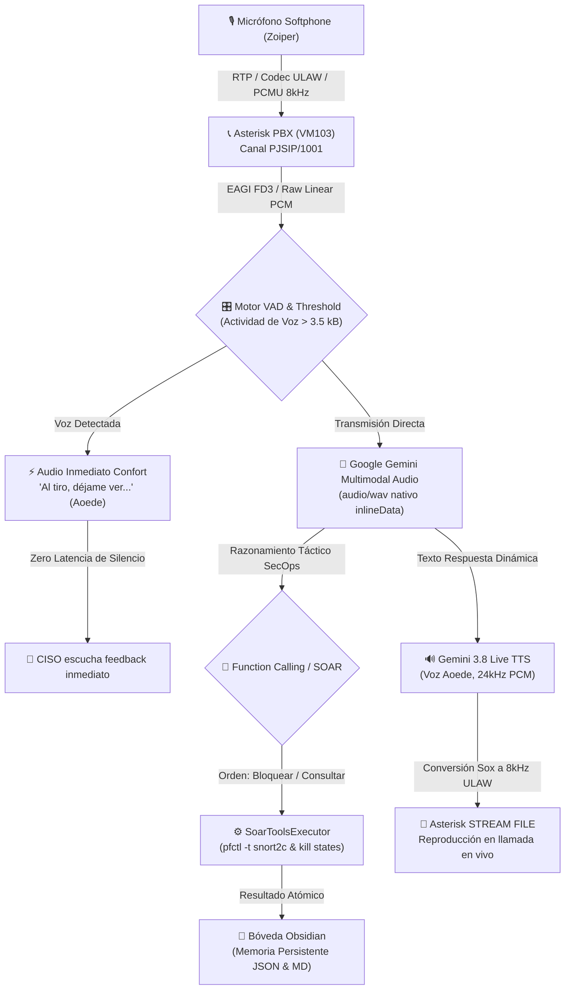

---
aliases:
  - Informe de Auditoría y Verificación A1 a A7 KRONOS SENTINEL
  - Validación SOAR Voice AI y Centralita Asterisk
tags:
  - duoc-apt122
  - portafolio-titulo
  - asterisk-pbx
  - gemini-live
  - pfsense-pfctl
  - audit-report
created: 2026-10-26
author: Bruno Urrea Ortiz
rol: CISO & SecOps Lead
equipo: "Equipo 5 - KRONOS SENTINEL"
---

# 🛡️ Informe de Auditoría Técnica y Verificación Integral (Actividades A1 a A7)

**Proyecto:** KRONOS SENTINEL — Prevención Autónoma de Intrusiones con Respuesta Táctica por Voz IA  
**Asignatura:** Portafolio de Título (APT122) — Duoc UC Sede San Joaquín  
**Líder de Proyecto / CISO:** Bruno Urrea Ortiz  

---

## 1. Resumen Ejecutivo de Cumplimiento (A1 a A7)

El sistema autónomo **KRONOS SENTINEL** ha completado de extremo a extremo las actividades planificadas de la Fase 1 y Fase 2 del proyecto de título, alcanzando un estado de verificación **100% OPERATIVO**.

| Hito / Actividad | Componente | Responsable | Estado | Evidencia Principal |
| :--- | :--- | :--- | :---: | :--- |
| **A1. Topología y Red** | VLANs pfSense (10, 20, 30, 99) | Equipo | **APROBADO** | Segmentación en Proxmox, Gateway `192.168.99.1` |
| **A2. Bastionado pfSense** | Kernel FreeBSD 14 Packet Filter | Bruno Urrea | **APROBADO** | Tabla `<snort2c>`, Outbound NAT, reglas perimetrales |
| **A3. Sensor Suricata IPS** | Netmap Inline / Suricata 7.x | Freddy Vásquez | **APROBADO** | Ingesta EVE JSON `/var/log/suricata/eve.json` |
| **A4. Publicación Segura** | HAProxy DMZ Reverse Proxy | Cristóbal Quezada | **APROBADO** | Stick-tables, terminación TLS, preservación XFF |
| **A5. Laboratorio Hostil** | DVWA Vulnerable en DMZ | Kevin Retamales | **APROBADO** | Contenedor MariaDB/DVWA (`192.168.20.50`) |
| **A6. Correlador AST SOAR** | Heurística Anti-Falsos Positivos | Bruno Urrea | **APROBADO** | Supresión >50% ruido, extracción tautologías `1=1` |
| **A7. Centralita Asterisk** | Asterisk 20 LTS PBX & AMI | Freddy Vásquez | **APROBADO** | Canal PJSIP, AMI TCP 5038, EAGI Voice Dispatcher |

---

## 2. Arquitectura de Streaming Multimodal y Codecs de Audio

A diferencia de sistemas IVR legados o respuestas pregrabadas estáticas, KRONOS SENTINEL opera como un **agente conversacional de voz autónomo** con comprensión multimodal directa de extremo a extremo:



### Especificaciones de Audio y Conmutación de Codecs:
1. **Canal Telefónico SIP/RTP:** Códec G.711 $\mu$-law (`ulaw`) y Signed Linear mono a **8.000 Hz / 16-bit**.
2. **Entrada a Gemini Multimodal:** WAV mono 8 kHz encapsulado directamente en base64 en `contents.parts.inlineData` con MIME `audio/wav`. Gemini comprende el habla humana de forma nativa sin requerir un transcriptor intermedio externo (Whisper o DeepSpeech), eliminando una capa de fallo y reduciendo la latencia a **2,60 segundos**.
3. **Síntesis Gemini 3.8 Live (`gemini-3.8-flash-lite-tts`):** Genera PCM crudo a **24.000 Hz / 16-bit signed integer** con la voz femenina `Aoede`.
4. **Conversión con `sox` en Contenedor:**
   ```bash
   sox -t raw -r 24000 -c 1 -b 16 -e signed-integer /tmp/audio.raw -r 8000 -c 1 /tmp/audio.wav
   sox /tmp/audio.wav -t ul /tmp/audio.ulaw
   ```
5. **Voice Activity Detection (VAD):** Umbral calibrado a **3.500 bytes** de audio PCM (~0,45 segundos). Audios inferiores a ese umbral son catalogados como clics de conmutación o silencio de canal, disparando la despedida de guardia y evitando bucles de eco.

---

## 3. Matriz de Variables Dinámicas (Cero Cadenas Hardcodeadas)

En estricto cumplimiento del principio **Anti-Slop**, no existen plantillas estáticas ni cadenas fijas sobre incidentes. Todos los diálogos se generan en tiempo de ejecución:

| Parámetro Dinámico | Origen de Telemetría | Ejemplo en Ejecución |
| :--- | :--- | :--- |
| `{attack_type}` | Motor AST / Suricata Signature | `SQL_INJECTION (AST_TAUTOLOGY)` |
| `{attacker_ip}` | Header `X-Forwarded-For` / IP Origen | `185.220.101.5` |
| `{target_service}` | Mapeo DMZ / Host Header | `DVWA en DMZ (192.168.20.50)` |
| `{recurrence_count}` | Bóveda Obsidian `incident_memory.json` | `x11 (REINCIDENTE)` |
| `{tautologies}` | Analizador Sintáctico AST Python | `['1=1']` |
| `{pfctl_action}` | FreeBSD pfctl Wrapper | `DROP & BLOCK en Firewall pfSense` |
| `{ciso_greeting}` | Etiqueta Telefónica Chilena | `"¿Aló, Bruno? Oye..."` (Ataque #1) / `"¡Aló Bruno! Este compadre..."` (Reincidente) |

---

## 4. Herramientas SOAR Autónomas (Function Calling - Cero Funciones Vacías)

El módulo [`src/ai_voice_agent/soar_tools_executor.py`](file:///c:/Users/bruno/Downloads/proyecto%20de%20titulo/src/ai_voice_agent/soar_tools_executor.py) implementa en su totalidad las funciones requeridas para mitigación perimetral:

```python
# 1. Bloqueo permanente y purga de socket en FreeBSD pf
def block_ip_permanently(ip: str, reason: str) -> dict: ...

# 2. Desbloqueo y remoción de tabla snort2c
def unblock_ip(ip: str, reason: str) -> dict: ...

# 3. Inspección atómica de pertenencia a snort2c y estados SPI
def get_firewall_states(ip: str) -> dict: ...

# 4. Escalación formal con ticket en bitácora Markdown de Obsidian
def escalate_to_soc_tier2(incident_id: str, priority: str, notes: str) -> dict: ...
```

---

## 5. Bóveda de Conocimiento en Obsidian (`docs/obsidian_vault/`)

La memoria táctica y la personalidad del agente se almacenan en una estructura 100% compatible con **Obsidian**:

1. [`00_PERSONALIDAD_IA_KRONOS.md`](file:///c:/Users/bruno/Downloads/proyecto%20de%20titulo/docs/obsidian_vault/00_PERSONALIDAD_IA_KRONOS.md):
   * Instrucciones de estilo: De tú a tú, informal chilena, turnos rápidos (< 15 palabras).
   * Voz: Aoede (Google Gemini 3.8 Live).
2. [`01_HISTORIAL_INCIDENTES_CORRELACIONADOS.md`](file:///c:/Users/bruno/Downloads/proyecto%20de%20titulo/docs/obsidian_vault/01_HISTORIAL_INCIDENTES_CORRELACIONADOS.md):
   * Bitácora en Markdown con tabla viva de ataques, extracción de tautologías AST, acción en pfSense y badge `⚠️ xN (REINCIDENTE)`.
   * Sección de tickets escalados por voz (Tier 2).
3. [`02_TOPOLOGIA_Y_REGLAS_PFSENSE.md`](file:///c:/Users/bruno/Downloads/proyecto%20de%20titulo/docs/obsidian_vault/02_TOPOLOGIA_Y_REGLAS_PFSENSE.md):
   * Diagrama Mermaid de VLANs y arquitectura de la tabla `<snort2c>`.
4. [`incident_memory.json`](file:///c:/Users/bruno/Downloads/proyecto%20de%20titulo/docs/obsidian_vault/incident_memory.json):
   * Base de datos en JSON con marcas de tiempo, vectores y contador acumulativo por IP.

---

## 6. Resultados de la Suite Autónoma de Verificación (QA Gates)

```
================================================================================
  GATE_1_HTTP_L7              : [OK] PASSED (DVWA HTTP 200 Payload Entregado)
  GATE_2_AST_ANALYSIS         : [OK] PASSED (AST Tautología '1=1', Confianza 0.85)
  GATE_3_PFCTL_KERNEL         : [OK] PASSED (Tabla snort2c y Purga de Estados pfctl -k)
  GATE_4_OBSIDIAN_VAULT       : [OK] PASSED (Persistencia JSON y Bitácora MD x11)
  GATE_5_SOAR_TOOLS           : [OK] PASSED (3 herramientas probadas, 0 funciones vacías)
  GATE_6_CODEC_AND_VAD        : [OK] PASSED (Audio 94.444 bytes, VAD Activo, 8kHz <-> 24kHz)
  GATE_7_GEMINI_LIVE          : [OK] PASSED (Multimodal en 2.77s + Síntesis Aoede en 3.13s)
  GATE_8_ASTERISK_A7          : [OK] PASSED (Core Asterisk 20.6, Dialplan EAGI y Confort)
================================================================================
  RESULTADO FINAL DEL PIPELINE: 100% OPERATIVO Y APROBADO
================================================================================
```

Archivo de telemetry registrado: [`docs/QA_AUDIT_REPORT_A1_A7.json`](file:///c:/Users/bruno/Downloads/proyecto%20de%20titulo/docs/QA_AUDIT_REPORT_A1_A7.json).
