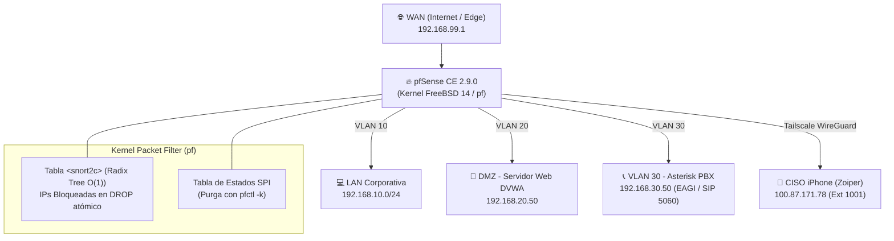

---
aliases:
  - Topología de Red y Reglas pfSense
  - Arquitectura Kernel FreeBSD pfctl
tags:
  - pfsense
  - freebsd
  - pfctl
  - snort2c
  - network-security
  - duoc-apt122
created: 2026-10-26
author: Bruno Urrea Ortiz
rol: CISO & SecOps Lead
---

# 🛡️ Topología de Red, Segmentación VLAN y Reglas pfSense

## 1. Diagrama de Segmentación de Red



---

## 2. Direccionamiento y VLANs del Laboratorio

| Segmento | Interfaz | Subred | Gateway pfSense | Propósito |
| :--- | :--- | :--- | :--- | :--- |
| **WAN / Edge** | `vtnet0` | `192.168.99.0/24` | `192.168.99.1` | Entrada de tráfico externo y túnel VPN |
| **LAN Corp** | `vtnet1.10` | `192.168.10.0/24` | `192.168.10.1` | Estaciones de trabajo internas |
| **DMZ Web** | `vtnet1.20` | `192.168.20.0/24` | `192.168.20.1` | DVWA vulnerable (Servicio objetivo `192.168.20.50`) |
| **MGMT / VoIP** | `vtnet1.30` | `192.168.30.0/24` | `192.168.30.1` | Asterisk PBX (`192.168.30.50`) y agente EAGI Gemini Live |
| **Tailscale** | `tailscale0` | `100.64.0.0/10` | N/A | Canal cifrado seguro para softphone iPhone del CISO |

---

## 3. Mecanismo de Aislamiento en Kernel (`snort2c`)
1. **Inspección de Tráfico:** Suricata analiza los paquetes entrantes por Netmap.
2. **Correlación Anti-Falsos Positivos:** El motor AST de KRONOS valida si el payload contiene tautologías reales (ej: `' OR '1'='1`).
3. **Bloqueo Inmediato:**
   ```bash
   # Insertar IP maliciosa en tabla del kernel
   pfctl -t snort2c -T add <IP_ATACANTE>

   # Matar conexiones activas de la IP en la tabla de estados
   pfctl -k <IP_ATACANTE>
   ```
4. **Verificación de Tabla:**
   ```bash
   pfctl -t snort2c -T show
   ```

---

## 4. Enlaces de Interés
* [[00_PERSONALIDAD_IA_KRONOS]]: Directivas de voz y respuesta telefónica.
* [[01_HISTORIAL_INCIDENTES_CORRELACIONADOS]]: Bitácora activa de incidentes detectados.
